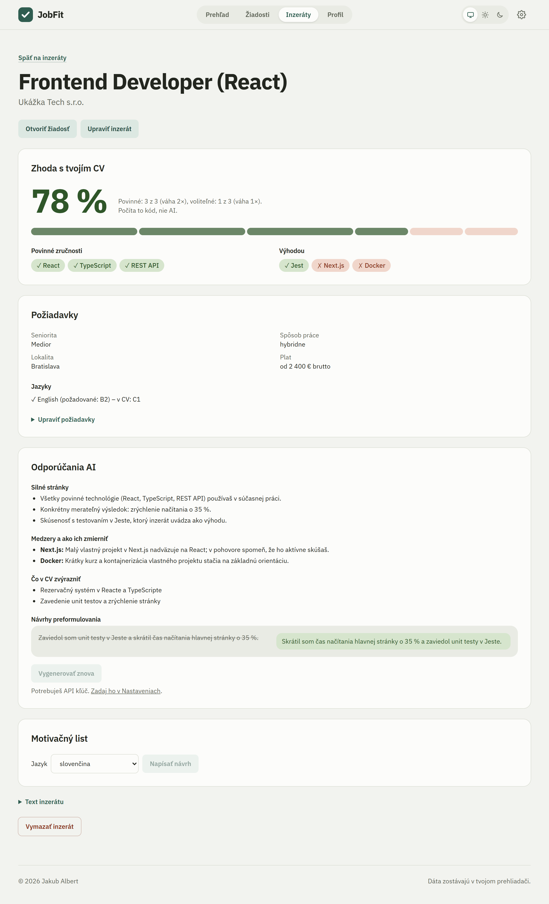
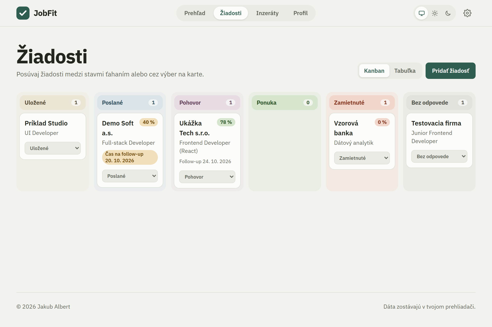
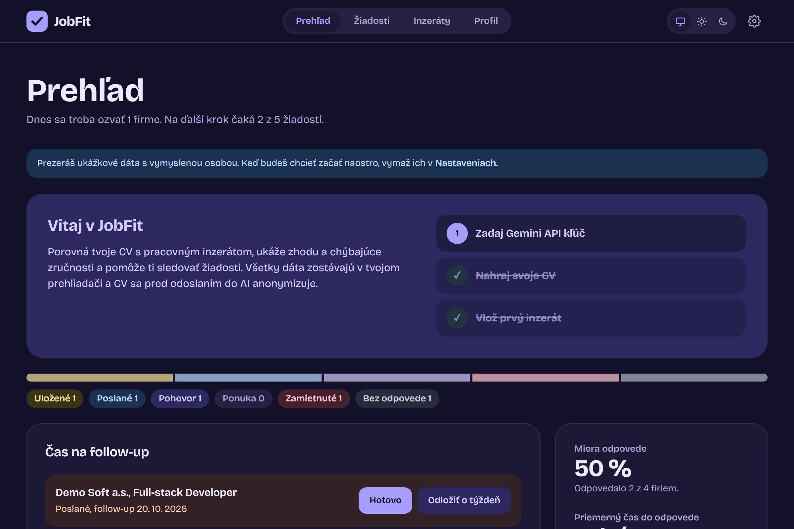
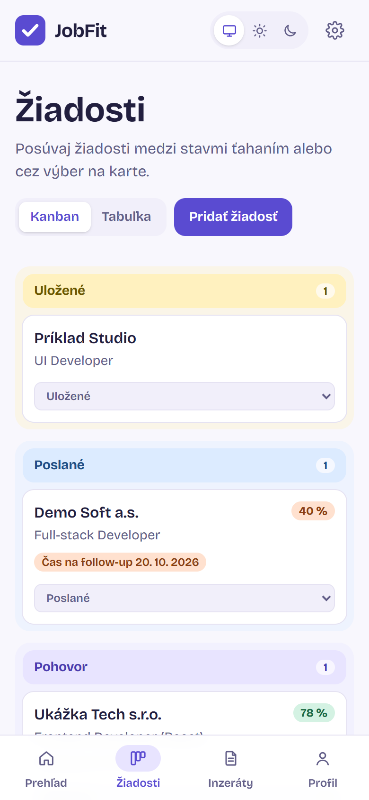
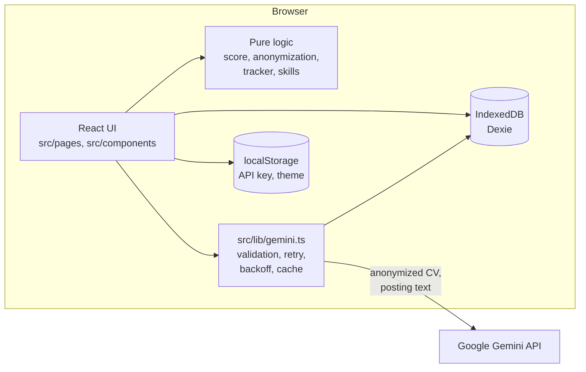

# JobFit

A job search assistant that runs entirely in the browser. It compares your CV with a job posting,
shows the match and the missing skills, suggests what to highlight, drafts a cover letter, and
tracks all your applications.

**Live demo:** https://jakubalbert.github.io/jobfit/ — click *Vyskúšať s ukážkovými dátami* on the
overview to explore it with sample data, no API key needed. The UI is in Slovak.



| Application tracker | Overview (dark mode) | Mobile |
| --- | --- | --- |
|  |  |  |

## Why

Applying for jobs means reading dozens of postings, guessing how well you fit, tailoring the CV
each time and keeping track of who you wrote to and when to follow up. JobFit does the tedious
parts. I also built it as a portfolio project, so every decision below is deliberate and explained.

## Features

- **CV profile** – paste text or upload a PDF (text extracted in the browser with pdf.js). Gemini
  turns it into structured data (skills, experience, education, languages, certificates) that you
  can review and edit. Personal data is removed before anything is sent. Several CV versions
  (e.g. frontend and fullstack); each posting can be compared with a chosen one.
- **Job posting analysis** – Gemini extracts must-have and nice-to-have skills, seniority,
  location, work mode, salary and languages; a level named in the job title is read by code.
  Everything can be corrected by hand, and an edited posting is analysed again.
- **Match score** – computed by plain code, with the full breakdown shown (see below). Your own
  skill synonyms can be added on top of the built-in dictionary.
- **AI advice** – strengths, gaps and how to mitigate them, what to highlight, and rewrite
  suggestions for CV bullet points. Likely interview questions with points from the CV to answer
  them. Optional cover letter draft in Slovak or English.
- **Application tracker** – kanban (drag and drop or a status select) and a sortable, searchable
  table. Dates fill in automatically, a follow-up reminder is set 7 days after applying, and every
  status change is kept as a timeline. Follow-up and interview export to any calendar (.ics).
- **Overview** – applications due for a follow-up, where all applications stand, response rate
  and average time to response.
- **Data** – JSON export and import (backup, moving between devices), delete everything.
- Every screen has an address, so Back works and postings can be bookmarked. Dark mode, works on
  phones, onboarding for the first run, sample data.

## Architecture



There is no server. The app is a static build on GitHub Pages; the only network call it makes is
to the Gemini API, with the user's own key.

## Key decisions

**No backend.** Nothing to run, pay for or secure, and the user's data never touches a server I
operate. The price: data lives in one browser, which is why there is JSON export and import.

**The score is computed by code, not by AI.** An LLM gives different numbers for the same input
and cannot explain them. Code gives the same score every time, and every point can be traced.
AI is used only where it is good: reading free text and writing advice. The insights prompt
receives the computed match as input; it explains the score but cannot change it.

**Anonymization is deterministic, not AI.** On the free tier Google may use submitted data for
training, so personal data must never reach the model at all, and asking a model to remove it
would mean sending it. Emails, phone numbers, profile links and postal codes are matched by regex;
the name and address are entered once by the user and replaced exactly (ignoring case and
diacritics). The app shows exactly what will be sent. `parseCv()` anonymizes internally, so no
caller can send the raw CV by mistake. The candidate's name is put into the cover letter locally,
after the response arrives.

**AI output is validated and guarded.** Every response must match a Zod schema (the same schema is
converted to the JSON schema Gemini is asked to follow), with one retry on invalid output. Rewrite
suggestions are kept only if the text they claim to rewrite really exists in the CV, a code check
on top of the "never invent anything" rule in the prompt.

**One module talks to Gemini** ([`src/lib/gemini.ts`](src/lib/gemini.ts)). It handles validation,
retry, exponential backoff on HTTP 429 with a visible status for the user (the SDK's own silent
retries are turned off for that reason), readable error messages and a cache keyed by the SHA-256
of the request, so the same CV or posting is never sent twice. Tests mock this one dependency.

**Small and fast.** The Gemini SDK, pdf.js and every screen except the overview are loaded only
when first needed, which halves the initial bundle. No router library: a small hash router ([`src/lib/router.ts`](src/lib/router.ts)) gives
every screen an address; a hash is never sent to the server, so deep links work on static GitHub
Pages, which cannot rewrite `/jobfit/inzeraty/123` to `index.html`. No drag and drop library either:
native drag and drop plus a status select, which also covers touch screens and keyboards.

**No server for reminders.** Follow-ups and interviews export as an iCalendar file (written by hand:
escaping, UTF-8-aware line folding, all-day and floating-time events), so the user's own calendar
sends the reminders.

**Schema changes stay compatible.** New fields always get Zod defaults and new tables a new Dexie
version, so every backup ever exported still imports; tests check this for each change.

**Colour carries meaning.** Every application status has its own earthy pastel, used the same way in the
kanban columns, badges and the overview's pipeline bar, so a colour alone tells where an application
stands. The match score bar is built from the skills themselves (must-have segments twice as wide),
so it draws the scoring formula instead of decorating a number. Colours are semantic CSS tokens, so
dark mode is defined once in [`src/index.css`](src/index.css) instead of on every element. The
font (IBM Plex Sans) is bundled with the app rather than loaded from Google Fonts, so Gemini
stays the only external request.

**Dates without time.** Tracker dates are plain `YYYY-MM-DD` in local time, which avoids
off-by-one-day bugs around midnight UTC; "today" is a parameter so tests do not depend on the date.

## How the match score works

The score is computed by plain, deterministic code ([`src/lib/matchScore.ts`](src/lib/matchScore.ts)).

1. **Normalize every skill** ([`src/lib/skills.ts`](src/lib/skills.ts)): lowercase, remove diacritics
   and version numbers, then look the name up in a synonym dictionary
   ([`src/data/skillSynonyms.ts`](src/data/skillSynonyms.ts)). So `JS`, `javascript` and `JavaScript`
   are one skill, as are `Postgres` and `PostgreSQL`, or `React 18` and `ReactJS`.
2. **Match exactly** after normalization. There is intentionally no fuzzy matching: `Java` and
   `JavaScript` look similar but are different skills.
3. **Weight the groups.** A must-have skill is worth 2 points, a nice-to-have skill 1 point.
   A skill listed in both groups counts once, as must-have.

```
score = 100 × (2 × matched must-have + 1 × matched nice-to-have)
            / (2 × all must-have     + 1 × all nice-to-have)
```

Example: the posting requires React and TypeScript and lists Git as an advantage; the CV has React
and Git. Score = 100 × (2 + 1) / (4 + 1) = **60 %**.

If a posting lists no skills at all, there is no score (a 0 % would be misleading).
Languages are shown next to the score but are not part of it: levels such as "B2", "fluent" or
"komunikatívne" are too inconsistent to compare reliably in code.

## Privacy

- There is no backend. All data (CV, postings, applications) is stored in IndexedDB in your browser.
- AI features use the **Google Gemini API with your own key**. The key is stored only in your
  browser's `localStorage`, is sent only to Google, and is never part of an export.
- **On the free tier, Google may use submitted data to improve its models.** That is why the CV is
  anonymized before it is sent (see above) and why only structured CV data, not the original text,
  is used for advice and cover letters.
- No analytics or tracking of any kind.

## Tech stack

Vite, React 19, TypeScript (strict), Tailwind CSS 4, Dexie (IndexedDB), `@google/genai`, Zod,
pdf.js, IBM Plex Sans (self-hosted via Fontsource), Vitest, oxlint, GitHub Actions.

## Run locally

Requires Node.js 24.

```bash
npm install
npm run dev     # http://localhost:5173/jobfit/
npm test        # unit tests (Vitest)
npm run lint    # oxlint
npm run build   # type check and production build into dist/
npm run test:e2e  # end-to-end tests (Playwright) against the build; uses the installed Edge locally
```

Every push to `main` is linted, tested and built by GitHub Actions and deployed to GitHub Pages if
all checks pass ([`.github/workflows/ci.yml`](.github/workflows/ci.yml)).

### Gemini API key

1. Open [Google AI Studio](https://aistudio.google.com/apikey) and create a free API key.
2. In the app, open *Nastavenia* (Settings), paste the key and click *Otestovať kľúč* (Test key).
3. The model name is configurable (default `gemini-3.5-flash-lite`), in case Google renames models.

## Tests

About 190 unit tests (Vitest) cover the parts where a bug would silently give wrong results:
anonymization (including numbers that must *not* be treated as phone numbers), skill normalization
and synonyms, the match score, seniority from titles, Zod schemas and invalid AI responses, the
Gemini module with a mocked API (including HTTP 429 backoff and the cache), backup export and import
(including backups from before each schema change), tracker dates, history and statistics, the
calendar file format, routing and the demo data. UI components have smoke tests rendered to a string.

End-to-end tests (Playwright, [`e2e/`](e2e/)) run the production build in a real browser on desktop
and phone sizes: demo data, the score, the board, Back and deep links, status history, editing a
posting, custom synonyms and the calendar download. CI runs them on every push.

## Project structure

```
src/
  data/       synonym dictionary, demo data
  db/         Zod schemas (single source of types), Dexie database, backup
  lib/        logic: gemini, anonymize, pdf, skills, matchScore, applications, calendar, router, …
  prompts/    all prompts, kept short and separate from code
  components/ reusable UI
  pages/      screens
e2e/          end-to-end tests (Playwright)
docs/         original project spec (Slovak) and screenshots
```

## What I would improve next

- Comparing language levels on the CEFR scale where both sides use it.
- Statistics over time from the status history (e.g. time spent in each stage, applications per week).
- Offline support as an installable PWA; OCR for scanned PDF CVs.
- Optional sync between devices without giving up the no-backend model (e.g. an encrypted file in
  the user's own cloud storage).
